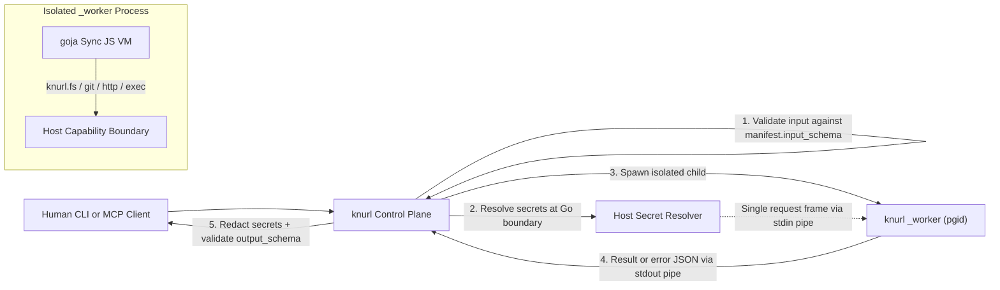
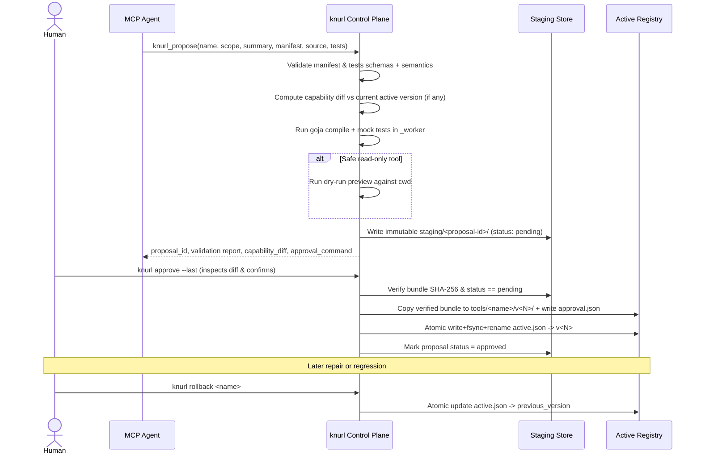

# System Architecture

`knurl` is a single static Go binary (`github.com/ViniTamanhao/knurl`) operating as either a human CLI or a stdio MCP server. It requires no background daemon, no embedded LLM, and no external runtime dependencies.

## 1. Component Boundaries

```text
cmd/knurl                   CLI entrypoint, flags, subcommands, hidden `_worker` entrypoint
internal/contract           Frozen JSON-serializable schemas, error codes, and MCP payloads
internal/registry           Two-tier repo/global resolution, version lookup, active.json reads
internal/approval           Staging store, validation pipeline, capability diff, atomic promote/rollback
internal/host               Capability-enforced fs (os.Root), git, http, exec templates, secrets/redaction
internal/runtime            Parent supervisor + `_worker` subprocess IPC + synchronous goja VM
internal/mcpserver          5 static MCP meta-tools wired to github.com/modelcontextprotocol/go-sdk/mcp
```

Dependency direction is strictly acyclic:

- `internal/contract` has zero dependencies on any other `internal/` package.
- `internal/host` and `internal/registry` depend only on `internal/contract` (and stdlib / approved libs).
- `internal/runtime` depends on `internal/contract` and `internal/host`.
- `internal/approval` depends on `internal/contract`, `internal/registry`, and `internal/runtime`.
- `internal/mcpserver` and `cmd/knurl` wire `internal/registry`, `internal/runtime`, and `internal/approval`.

## 2. Execution Isolation (`_worker` Subprocess IPC)

Every tool execution—whether via `knurl run`, `knurl_run`, `knurl_propose` test/dry-run validation, or `knurl_propose` mock execution—runs inside an ephemeral child process spawned by the parent binary (`knurl _worker`).



### IPC & Resource Control Invariants

- **Framing:** Single-request / single-response NDJSON over dedicated stdin/stdout pipes (`WorkerRequest` -> `WorkerResponse`), capped at 2 MiB per IPC frame.
- **Zero raw JS stdout:** Tool JavaScript has no `console` or `process.stdout` access. Only `knurl.log(msg)` emits diagnostic lines, captured inside `WorkerResponse.Diagnostics`.
- **Clean MCP stdio:** In `knurl mcp`, MCP protocol traffic owns `os.Stdout`. The `_worker` runs with its own dedicated pipes; any parent diagnostics go strictly to `os.Stderr`.
- **Deterministic cancellation:** Parent enforces `context.WithTimeout` (tool `timeout_ms`, default 30,000 ms, max 120,000 ms). On expiry, the parent interrupts the process group (`Setpgid: true`, `SIGKILL` to `-pgid` on Unix) so child processes spawned by `knurl.exec` cannot leak or orphan.
- **Secret isolation:** Only secret values actually referenced by the tool's declared `secrets` are passed into the worker request in memory over stdin pipe (never written to disk or process environment variables of the worker), and the parent scrubs all resolved secret values (plus base64/URL-encoded variants) from outputs, errors, and diagnostics before returning.

## 3. Two-Tier Registry & Resolution Order

`knurl` separates shared project tools from personal cross-project tools and unapproved drafts:

| Tier | Location | Precedence | Purpose |
| :--- | :--- | :--- | :--- |
| **Repo-local** | `./.knurl/tools/<name>/v<N>/` | 1st (default `auto` scope) | Project-specific workflows (e.g., `pr-ready`); committable to Git. |
| **Global** | `$KNURL_HOME/tools/<name>/v<N>/` or `$XDG_CONFIG_HOME/knurl/tools/<name>/v<N>/` (fallback `~/.config/knurl/tools/`) | 2nd | Personal ops/utility tools (e.g., `vps-health`). |
| **Staging** | `$KNURL_HOME/staging/<proposal-id>/` or `~/.config/knurl/staging/<proposal-id>/` | Never directly executable | Unapproved proposals and repairs awaiting `knurl approve`. |

When resolving a tool in `auto` scope:
1. Walk upward from `cwd` looking for `.knurl/tools/<name>/active.json`. Stop at the repository boundary (directory containing `.git`) or filesystem root.
2. If not found, check the global tools directory (`~/.config/knurl/tools/<name>/active.json`).
3. Passing explicit `--scope repo` or `--scope global` bypasses fallback.

## 4. Proposal, Approval & Rollback Flow


